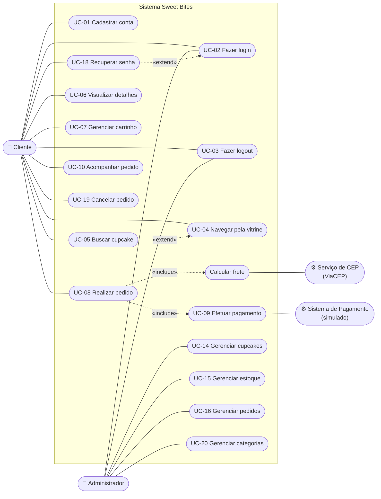

# 4. Casos de uso (revisados)

## 4.1 Diagrama de casos de uso geral

O GitHub não desenha diagramas de caso de uso UML nativos, por isso este foi feito com um fluxograma Mermaid que segue a notação: atores fora da fronteira do sistema, casos de uso como elipses, e `<<include>>`/`<<extend>>` nas setas pontilhadas.

**Correções feitas em relação ao PIT I:**
- O caso "Fazer login" estava **duplicado** e ligado a si mesmo. Agora há um único caso, compartilhado por Cliente e Administrador.
- Faltavam casos que existiam nas histórias: Recuperar senha, Logout, Buscar, Gerenciar pedidos. Também foram incluídos os casos novos (Cancelar pedido, Gerenciar categorias).
- O ator "Serviço de CEP" foi adicionado, porque a RN de validação de endereço depende dele.
- "Efetuar pagamento" passou a ser `<<include>>` de "Realizar pedido", já que não existe pagamento fora de um pedido.
- Os rótulos em inglês ("Customer", "Payment System") foram traduzidos.
- "Visualizar relatórios" saiu deste diagrama, por ser da Sprint 4.

## 4.2 Caso de uso expandido: UC-08 Realizar pedido (revisado)

| Campo | Descrição |
|---|---|
| **Identificador** | UC-08 |
| **Atores** | Cliente (principal), Serviço de CEP, Sistema de Pagamento |
| **Pré-condições** | Cliente autenticado e com ao menos um item no carrinho |
| **Pós-condições** | Pedido registrado, estoque reservado e cliente notificado. Status: "Em preparação" (cartão/dinheiro) ou "Aguardando pagamento" (PIX) |

**Fluxo principal**
1. O cliente abre o carrinho e toca em **Finalizar pedido**.
2. O sistema exibe a tela de checkout com o resumo dos itens (preços recalculados no servidor).
3. O cliente informa o **CEP**. *<Curso alternativo Alfa>*
4. O sistema consulta o CEP, preenche rua, bairro e cidade, e calcula **frete e tempo estimado** (RN: frete por zona).
5. O cliente informa número e complemento.
6. O cliente escolhe a **forma de pagamento**: cartão, PIX ou dinheiro.
7. O cliente toca em **Confirmar pedido**.
8. O sistema valida de novo, no servidor: estoque (com bloqueio da linha no banco), máximo de 20 por item, pedido mínimo de R$ 15,00 e frete. *<Curso alternativo Gama>*
9. O sistema processa o pagamento. *<Curso alternativo Beta>*
10. O sistema grava pedido, itens, pagamento e entrega numa **única transação** e baixa o estoque.
11. O sistema exibe a **tela de confirmação** com o número do pedido e a previsão de entrega, e esvazia o carrinho.
12. O sistema gera a notificação "Pedido confirmado".

**Curso alternativo Alfa: CEP inválido ou fora da área**
- A4. O CEP não existe ou fica fora do estado da loja.
- A5. O sistema mostra "CEP não encontrado. Verifique o endereço." ou "Ainda não entregamos em <cidade/UF>".
- A6. O caso de uso volta ao passo 3.

**Curso alternativo Beta: pagamento recusado**
- B9. O gateway recusa o cartão.
- B10. O sistema mostra "Pagamento não aprovado. Tente outro método de pagamento." **Nada é gravado e o estoque não é alterado.** O endereço continua preenchido.
- B11. O caso de uso volta ao passo 6.

**Curso alternativo Gama: estoque ou valor insuficiente** *(novo)*
- G8. Outro cliente comprou as últimas unidades, ou o subtotal ficou abaixo de R$ 15,00.
- G9. O sistema mostra a mensagem específica (ex.: "Red Velvet Morango: só temos 2 unidade(s) em estoque.").
- G10. O cliente volta ao carrinho para ajustar.

**Fluxo PIX** *(detalhado)*: no passo 9 o sistema gera o QR Code e o código "copia e cola", válidos por 30 minutos, e o pedido fica "Aguardando pagamento". Quando o pagamento é confirmado, o pedido passa para "Em preparação". Se o PIX vence sem pagamento, um job cancela o pedido e devolve o estoque.

## 4.3 Caso de uso expandido: UC-01 Cadastrar conta (revisado)

| Campo | Descrição |
|---|---|
| **Identificador** | UC-01 |
| **Ator** | Cliente |
| **Pré-condições** | Não existe conta com o mesmo e-mail |
| **Pós-condições** | Conta criada com o perfil CLIENTE; e-mail de boas-vindas enviado (simulado) |

**Fluxo principal**
1. O usuário toca em **Cadastre-se** na tela de login.
2. O sistema exibe o formulário: Nome, E-mail, Telefone, Senha e Confirmar senha.
3. O usuário preenche e toca em **Criar conta**.
4. O sistema valida os campos (RN01: e-mail único; RN02: senha com 8 caracteres ou mais, com letras e números; telefone com DDD; confirmação igual à senha). *<Curso alternativo Alfa>*
5. O sistema grava a conta com a senha criptografada (BCrypt).
6. O sistema envia o e-mail de boas-vindas.
7. O sistema volta para o login com a mensagem "Conta criada com sucesso!".

**Curso alternativo Alfa: dados inválidos**
- A4. Um ou mais campos são inválidos.
- A5. O sistema destaca os campos em vermelho e mostra **uma** mensagem embaixo de cada um.
- A6. O caso de uso volta ao passo 3, mantendo os dados já digitados (exceto as senhas).

## 4.4 Caso de uso expandido: UC-16 Gerenciar pedidos *(novo)*

| Campo | Descrição |
|---|---|
| **Ator** | Administrador |
| **Pré-condições** | Administrador autenticado |
| **Pós-condições** | Status do pedido alterado e cliente notificado |

**Fluxo principal**
1. O administrador abre **Pedidos** e, se quiser, filtra por status e período.
2. O administrador abre um pedido.
3. O sistema mostra itens, cliente, endereço, pagamento e o botão do próximo status permitido.
4. O administrador toca em **Marcar como: <próximo status>**.
5. O sistema atualiza o status e notifica o cliente. Se o pedido em dinheiro for entregue, marca o pagamento como pago.

**Curso alternativo: cancelar.** O administrador toca em **Cancelar pedido** e confirma. O sistema devolve o estoque e estorna o pagamento aprovado. Pedidos **entregues** não exibem essa opção, e o servidor também recusa o cancelamento.
