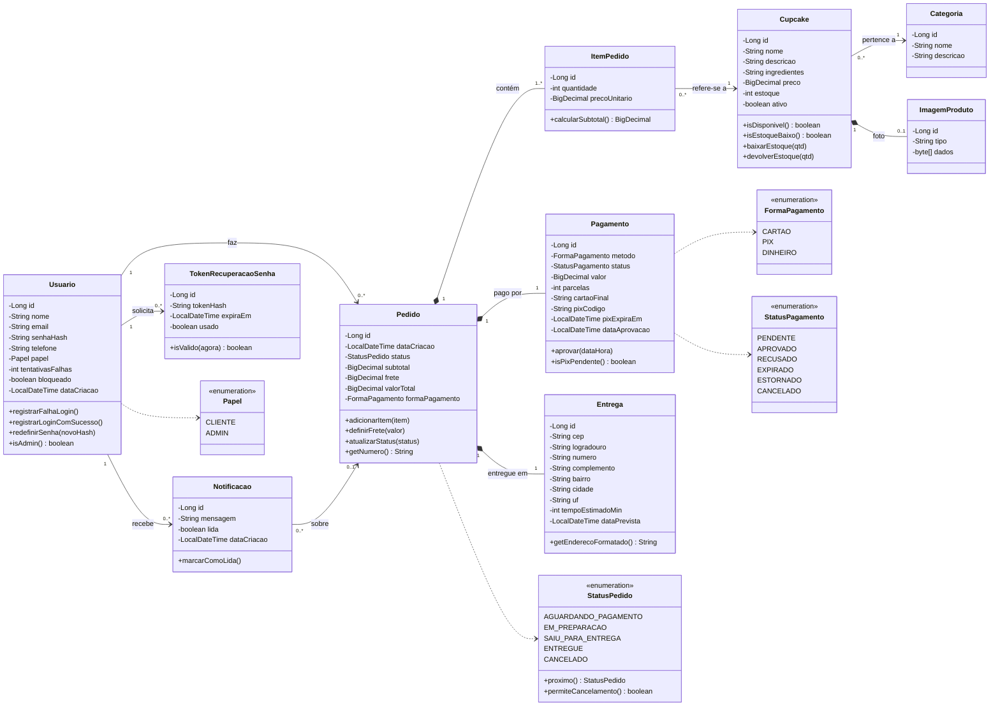

# 5. Diagrama de classes (revisado)

Este é o diagrama do modelo de domínio, ou seja, das classes de persistência que de fato existem no código, em `situacao-2-codificacao/src/main/java/br/com/sweetbites/model`.

## O que foi corrigido em relação ao diagrama do PIT I

| # | Problema no PIT I | Correção |
|---|---|---|
| 1 | A classe **Pagamento aparecia duas vezes**, e uma delas tinha os atributos de Entrega | Uma única classe `Pagamento`, com método, status, valor, parcelas e dados do PIX |
| 2 | Atributos de **Entrega ilegíveis** ("endercc Entrega", "valorPrvoant") | `Entrega` com endereço completo (CEP, rua, número, bairro, cidade, UF) e previsão |
| 3 | `Pedido` ligado **diretamente** a `Cupcake` (1..1) | A ligação passa por `ItemPedido`: um pedido tem vários itens, e cada item aponta para um cupcake |
| 4 | `Categoria` ligada a `ItemPedido` | `Categoria` ligada a `Cupcake`, que é quem de fato tem categoria |
| 5 | Composição Usuario ◆ Pedido | Associação simples: o pedido não é "parte" do usuário e é preservado como histórico |
| 6 | Valores monetários como `Float` | `BigDecimal`, para não acumular erro de arredondamento em dinheiro |
| 7 | `Usuario.endereco` como texto solto | O endereço fica em `Entrega`, uma por pedido; o cliente pode receber em locais diferentes |
| 8 | Sem perfil de acesso | `Papel` (CLIENTE/ADMIN) separa o que cada um pode fazer |
| 9 | Status como `String` livre | Enumerações (`StatusPedido`, `StatusPagamento`, `FormaPagamento`), com as transições permitidas codificadas |
| 10 | Faltavam classes exigidas pelas histórias | `Notificacao` (US-10), `TokenRecuperacaoSenha` (US-18), `ImagemProduto` (US-14), além de `tentativasFalhas`/`bloqueado` (US-02) |
| 11 | `Usuario.senha` em texto | `senhaHash`: só o hash BCrypt é guardado |

> O diagrama original continua disponível em [`imagens/pit1-original/diagrama-de-classes.jpg`](imagens/pit1-original/diagrama-de-classes.jpg), para comparação.
