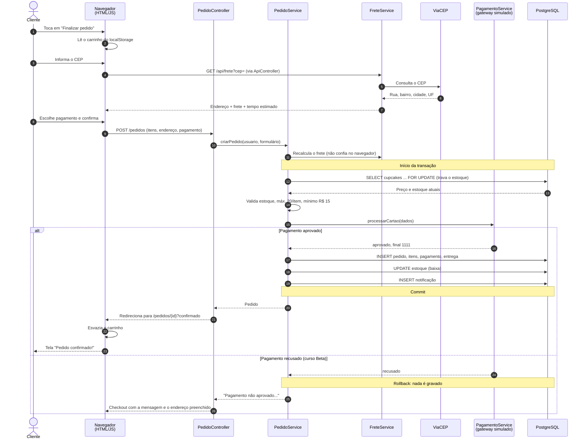
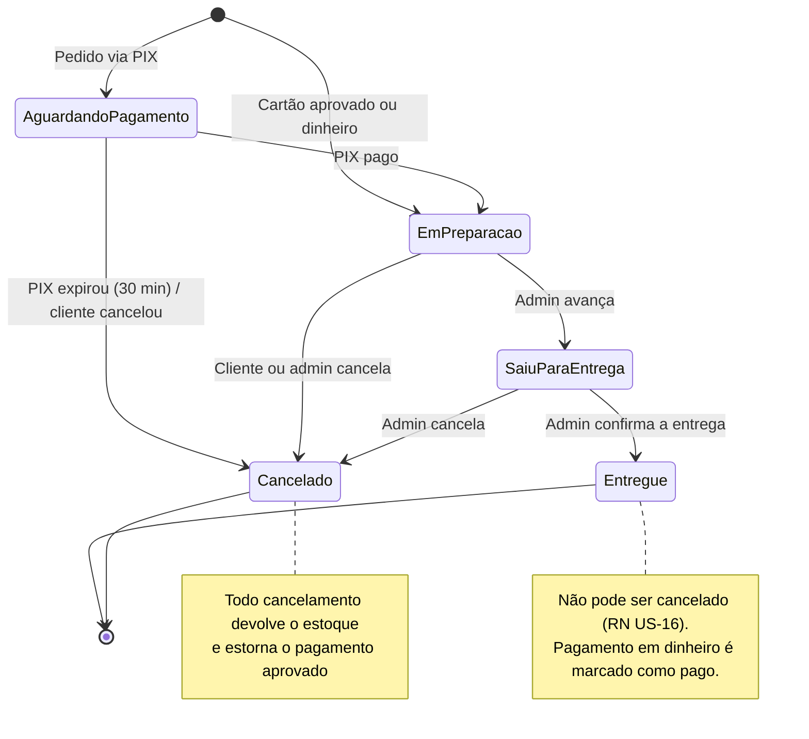
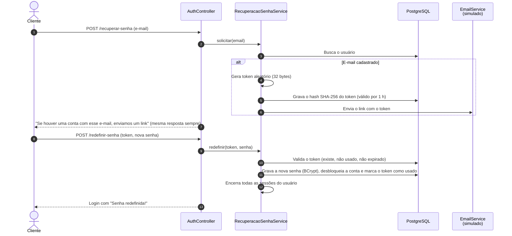

# 6. Diagramas comportamentais (revisados)

## 6.1 Diagrama de sequência: Realizar pedido (UC-08)

**Correções em relação ao PIT I:**
- No diagrama original, o **app enviava os dados do cartão direto ao Sistema de Pagamento**, sem passar pelo servidor. Isso permite alterar valores pelo cliente e expõe credenciais do gateway no aplicativo. Agora **só o servidor** fala com o gateway, e o valor cobrado é calculado no servidor.
- Incluídos a **consulta de CEP**, o **bloqueio de estoque** (evita vender a última unidade para dois clientes) e o fluxo de **recusa com rollback**.
- O título duplicado ("'Realizar Pedido' app - Realizar Pedido") foi corrigido.

## 6.2 Diagrama de estados: ciclo de vida do pedido *(novo)*

As transições permitidas ficam no próprio enum `StatusPedido` (`proximo()` e `permiteCancelamento()`) e são verificadas no servidor. Por isso, mesmo uma chamada feita fora da tela não consegue, por exemplo, cancelar um pedido entregue.

## 6.3 Diagrama de sequência: Recuperar senha (UC-18) *(novo)*

