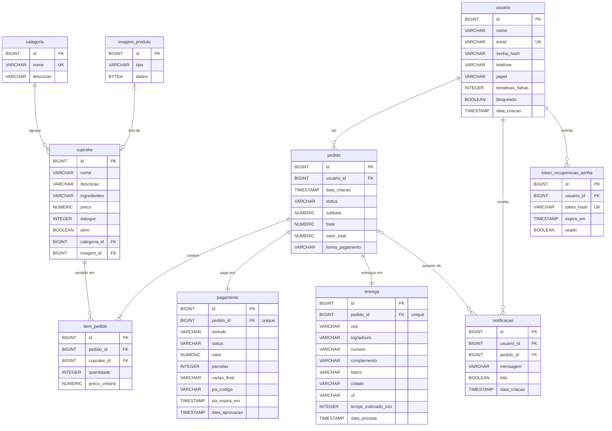

# 7. Projeto físico do banco de dados

- **SGBD:** PostgreSQL 16. É popular, gratuito, tem bom suporte em hospedagens e está entre os mais usados do mercado, como o material da disciplina recomenda.
- **Versionamento do esquema:** Flyway. O script [`V1__criar_tabelas.sql`](../situacao-2-codificacao/src/main/resources/db/migration/V1__criar_tabelas.sql) é aplicado automaticamente quando a aplicação sobe. Mudanças futuras entram em novos scripts (`V2__...`), nunca editando os já aplicados.
- **Validação:** ao iniciar, o Hibernate confere se as tabelas batem com as entidades Java (`ddl-auto=validate`).

## 7.1 Diagrama entidade-relacionamento

## 7.2 Dicionário de dados (tabelas principais)

### `usuario`
| Coluna | Tipo | Nulo | Regra |
|---|---|---|---|
| id | BIGINT identity | não | Chave primária |
| nome | VARCHAR(120) | não | |
| email | VARCHAR(160) | não | **Único**, guardado em minúsculas (RN US-01) |
| senha_hash | VARCHAR(100) | não | Hash BCrypt, nunca a senha em texto |
| telefone | VARCHAR(20) | não | Com DDD |
| papel | VARCHAR(20) | não | `CLIENTE` ou `ADMIN` |
| tentativas_falhas | INTEGER | não | Padrão 0; ao chegar a 5, bloqueia (RN US-02) |
| bloqueado | BOOLEAN | não | Padrão `false` |

### `cupcake`
| Coluna | Tipo | Nulo | Regra |
|---|---|---|---|
| preco | NUMERIC(10,2) | não | `CHECK (preco > 0)` |
| estoque | INTEGER | não | `CHECK (estoque >= 0)`: o banco impede estoque negativo |
| ativo | BOOLEAN | não | `false` = removido do cardápio (exclusão lógica, RN US-14) |
| categoria_id | BIGINT | não | FK → `categoria` |
| imagem_id | BIGINT | sim | FK → `imagem_produto` |

### `pedido` / `item_pedido`
| Coluna | Tipo | Regra |
|---|---|---|
| pedido.status | VARCHAR(30) | Valores de `StatusPedido` (ver o diagrama de estados) |
| pedido.subtotal, frete, valor_total | NUMERIC(10,2) | `valor_total = subtotal + frete` |
| item_pedido.quantidade | INTEGER | `CHECK (quantidade BETWEEN 1 AND 20)` (RN US-07) |
| item_pedido.preco_unitario | NUMERIC(10,2) | **Preço do momento da compra**: se o cupcake mudar de preço depois, o histórico não muda |

### `pagamento`
| Coluna | Regra |
|---|---|
| pedido_id | **Único**: exatamente um pagamento por pedido |
| cartao_final | Só os 4 últimos dígitos; o número completo e o CVV nunca são gravados |
| pix_expira_em | Data de criação + 30 min (RN US-09) |

### `token_recuperacao_senha`
| Coluna | Regra |
|---|---|
| token_hash | SHA-256 do token. Quem tiver acesso ao banco não consegue usar o link |
| expira_em | Criação + 1 h (RN US-18) |
| usado | O token vale para uma única redefinição |

## 7.3 Índices

| Índice | Motivo |
|---|---|
| `uk_usuario_email` | Login e checagem de e-mail único |
| `ix_cupcake_categoria` | Filtro da vitrine por categoria |
| `ix_pedido_usuario` | Tela "Meus pedidos" |
| `ix_pedido_status_data` | Filtro do admin por status e período |
| `ix_item_pedido_pedido`, `ix_item_pedido_cupcake` | Montar o pedido; verificar se o cupcake está em pedido ativo antes de removê-lo |
| `ix_pagamento_status_metodo` | Job que procura PIX vencido a cada minuto |
| `ix_notificacao_usuario` | Contador de notificações não lidas no topo de toda tela |

## 7.4 Por que a imagem fica no banco (BYTEA)?

Hospedagens gratuitas (Render) apagam o disco local a cada novo deploy, então uma foto salva em pasta sumiria. Guardar a imagem no PostgreSQL mantém tudo num lugar só, com backup junto do banco. Como a foto é carregada sob demanda (`LAZY`) e servida com cache de 7 dias, isso não pesa na listagem da vitrine.
