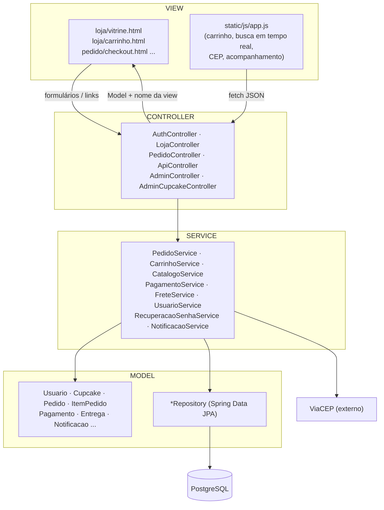
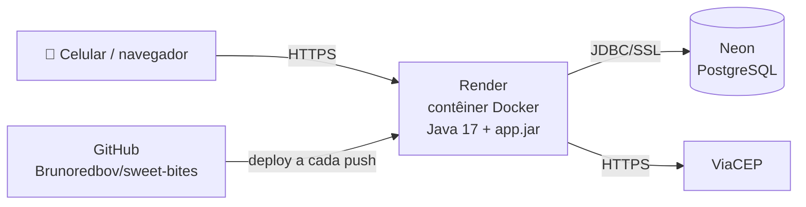

# 8. Arquitetura da solução

## 8.1 Padrão MVC

O material da disciplina indica o padrão **MVC**, e a aplicação segue esse padrão com Spring MVC. Por boa prática, as regras de negócio ficam numa camada de *services*, separada dos controllers.

| Camada | Responsabilidade | Exemplo |
|---|---|---|
| View | Apresentação. Não decide regra de negócio | `pedido/checkout.html` mostra o formulário e o resumo |
| Controller | HTTP: lê parâmetros, chama o service e escolhe a próxima tela | `PedidoController.finalizar()` |
| Service | Regras de negócio e transações | `PedidoService.criarPedido()` valida estoque, mínimo e pagamento |
| Model | Estado e comportamento do domínio | `Cupcake.baixarEstoque()` impede estoque negativo |

## 8.2 Tecnologias

| Item | Escolha | Por quê |
|---|---|---|
| Linguagem | Java 17 (LTS) | Está na lista do material e tem suporte longo |
| Framework | Spring Boot 4 (MVC, Security, Data JPA, Validation) | Padrão de mercado para MVC em Java, e é o que os vídeos do material usam |
| Views | Thymeleaf + HTML5 + CSS3 + JavaScript puro | Exigência do material (HTML/CSS/JS), sem framework pesado no front |
| Banco | PostgreSQL 16 + Flyway | SGBD popular; o esquema fica versionado no Git |
| Testes | JUnit 5, Mockito, Spring MockMvc, H2 | 56 testes rodando em segundos, sem precisar de banco externo |
| Build | Maven (wrapper `mvnw`) | Quem clona o repositório não precisa instalar o Maven |
| Deploy | Docker → Render; banco no Neon | Planos gratuitos com URL pública e HTTPS |

## 8.3 Implantação

**Aplicação no ar:** https://sweet-bites-s1we.onrender.com

| Item | Configuração |
|---|---|
| Aplicação | Render, Web Service gratuito (512 MB), contêiner Docker gerado pelo `Dockerfile` de `situacao-2-codificacao`, região Ohio (EUA) |
| Banco | Neon, PostgreSQL 16 gratuito, região AWS US East 2 (Ohio), conexão com SSL |
| Esquema | Criado pelo Flyway na primeira subida (`V1__criar_tabelas.sql`) |
| Segredos | Variáveis de ambiente no painel do Render (`DATABASE_*`, `ADMIN_*`), nunca no código |
| Saúde | O Render consulta `/actuator/health`, que inclui a conexão com o banco |
| Atualização | Cada push na branch `main` gera um novo deploy automático |

No plano gratuito, o serviço "dorme" depois de 15 minutos sem uso, e o primeiro acesso seguinte pode levar cerca de 1 minuto. Localmente, a aplicação roda com `docker compose` (ver o [README do código](../situacao-2-codificacao/README.md)).

## 8.4 Segurança aplicada

| Ameaça | Proteção |
|---|---|
| Vazamento de senhas | BCrypt; o token de recuperação é guardado como hash SHA-256 |
| Força bruta no login | Bloqueio após 5 tentativas erradas |
| Formulário enviado por outro site (CSRF) | Token CSRF em todos os formulários (Spring Security) |
| Injeção de script (XSS) | Thymeleaf escapa o HTML por padrão, e a Content-Security-Policy proíbe scripts inline |
| Cliente vendo pedido de outro | Checagem de dono em toda consulta. Resposta 404 (não 403), para não revelar que o pedido existe |
| Alteração de preço pelo navegador | O servidor recalcula itens, preços, frete e total |
| Venda acima do estoque (concorrência) | `SELECT ... FOR UPDATE` no estoque dentro da transação |
| Upload malicioso | Só JPG/PNG de até 5MB, com o formato conferido pelos bytes do arquivo |
| Dados de cartão | Nunca gravados, só os 4 últimos dígitos |
| Senha do admin no código | O admin é criado a partir de variáveis de ambiente (`ADMIN_EMAIL`/`ADMIN_SENHA`) |

## 8.5 Integrações simuladas

| Integração | Situação | Como trocar pela real |
|---|---|---|
| CEP | **Real** (ViaCEP) | — |
| Gateway de cartão | Simulada (`PagamentoService`) | Implementar a chamada ao Mercado Pago ou Stripe no mesmo service |
| PIX | Simulado (QR fictício + botão "Simular pagamento") | Usar a API PIX do gateway, com confirmação por webhook |
| E-mail | Simulado (`EmailSimuladoService` grava no log) | Criar uma nova implementação da interface `EmailService` (SMTP ou Resend) |
| Push | Notificação no app + atualização a cada 10 s | Firebase Cloud Messaging |

O **modo demonstração** (`MODO_DEMONSTRACAO=true`) mostra na tela os atalhos de teste: o link de redefinição de senha e o botão de pagar o PIX. Desligado, esses atalhos somem e o endpoint de simulação responde 404.
