# 9. Protótipos e telas implementadas

## 9.1 Do protótipo à tela real

A identidade visual dos mockups do PIT I foi mantida: rosa `#FF6B8A` e branco, cards com foto, botões arredondados e navegação inferior. Algumas mudanças surgiram na implementação:

| Protótipo PIT I | Implementação PIT II | Motivo |
|---|---|---|
| Login social (Google/Facebook) | Removido | Fora das histórias de usuário; exigiria contas de desenvolvedor |
| Ícone de favorito (coração) nos cards | Removido por enquanto | US-13 é da Sprint 4 |
| "Promo code" no carrinho | Removido | Não havia história de usuário |
| Avaliações (estrelas) na vitrine | Removido por enquanto | US-11 é da Sprint 4 |
| Navegação: Home, Favoritos, Cardápio, Carrinho, Perfil | Início, Pedidos, Carrinho, Perfil (+ Admin para administradores) | Pedidos ganhou atalho, já que acompanhar a entrega é central (US-10) |
| Fotos reais de cupcakes | Ilustrações vetoriais no cardápio de exemplo | O admin envia as fotos reais pelo painel (US-14) |
| — | Sino de notificações com contador | Substitui o push (US-10) |
| — | Linha do tempo do pedido | Deixa claro o status em tempo real (US-10) |

## 9.2 Mapa navegacional (revisado)

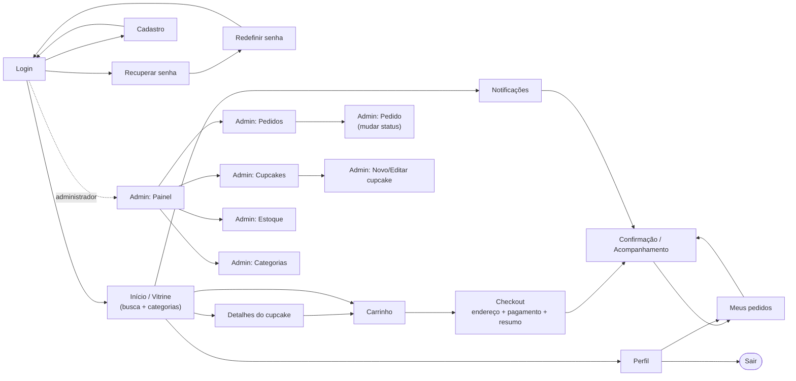

## 9.3 Telas do cliente (celular, 375 px)

| Login | Cadastro (validação) | Vitrine | Busca "morango" |
|---|---|---|---|
| 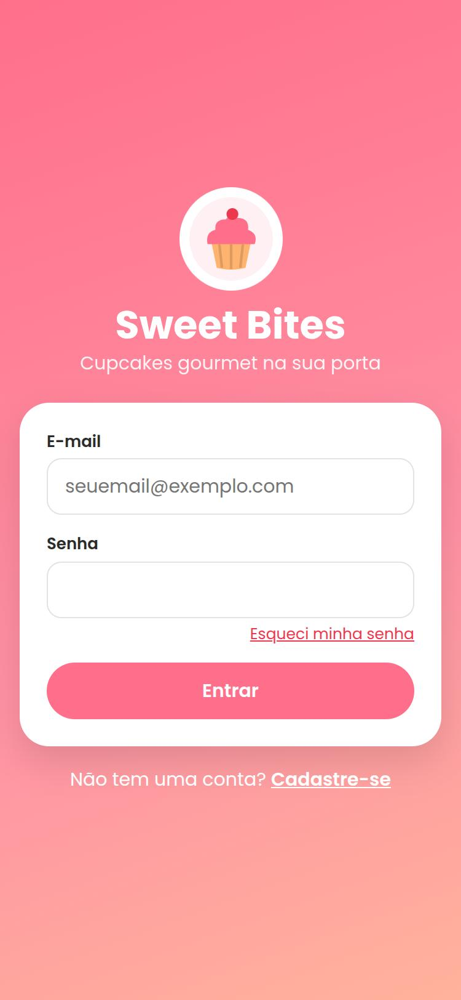 | 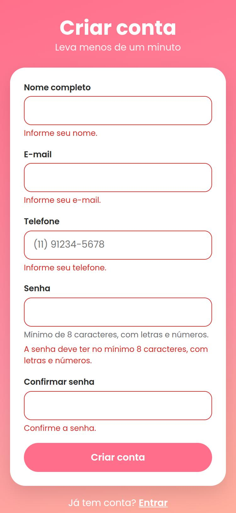 | 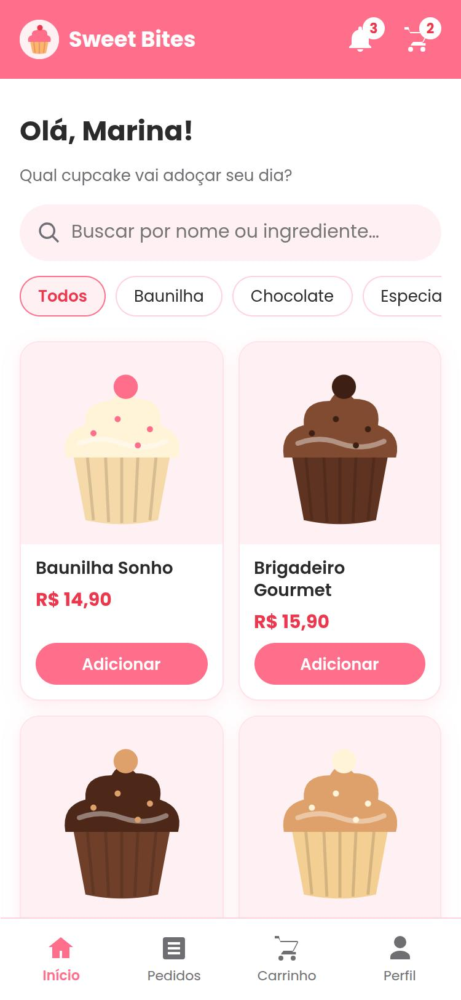 | 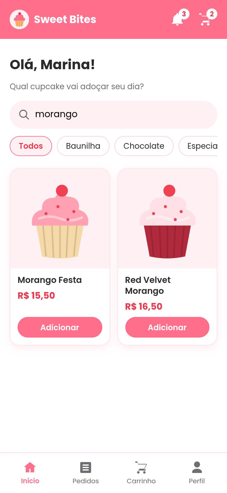 |

| Item indisponível | Detalhes | Carrinho | Checkout: endereço |
|---|---|---|---|
| 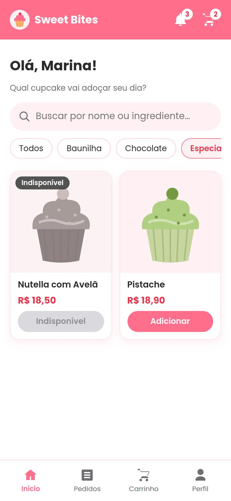 | 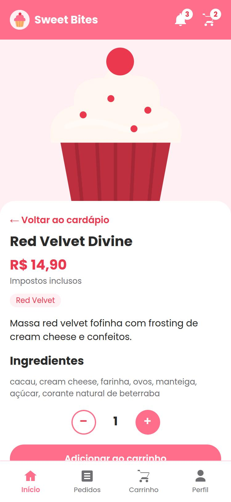 | 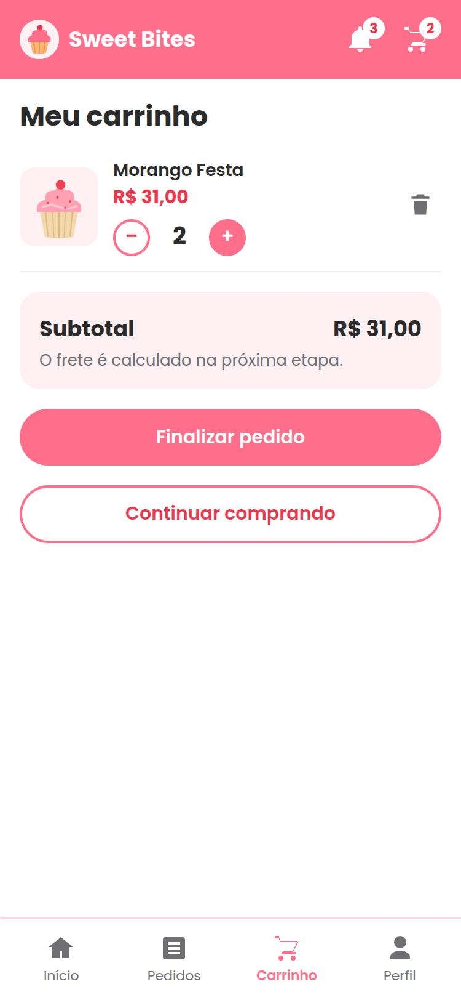 | 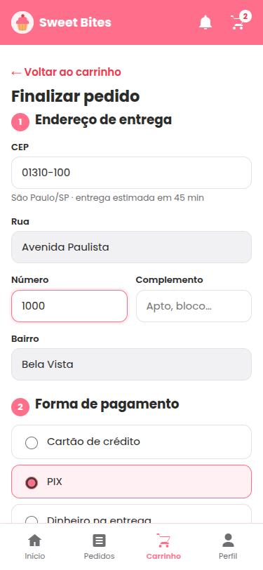 |

| Checkout: pagamento | Pagamento via PIX | Confirmação | Acompanhamento |
|---|---|---|---|
| 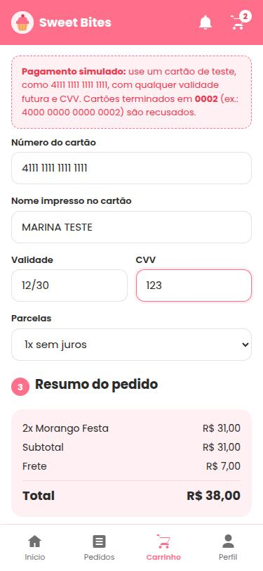 | 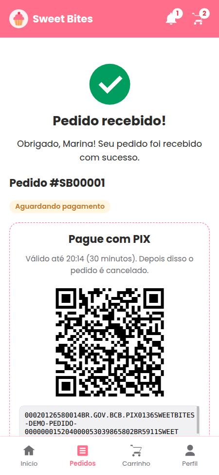 | 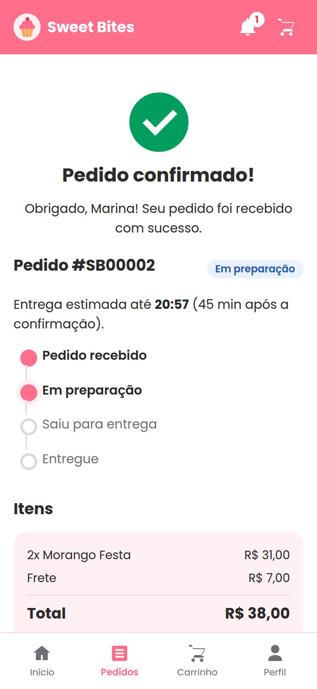 | 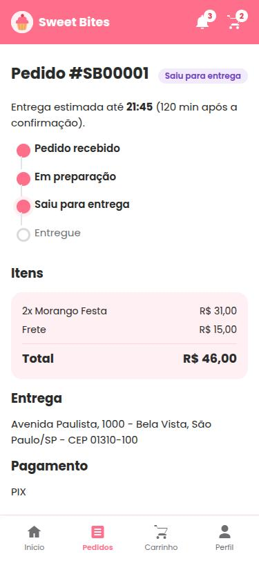 |

| Notificações | Meus pedidos |
|---|---|
| 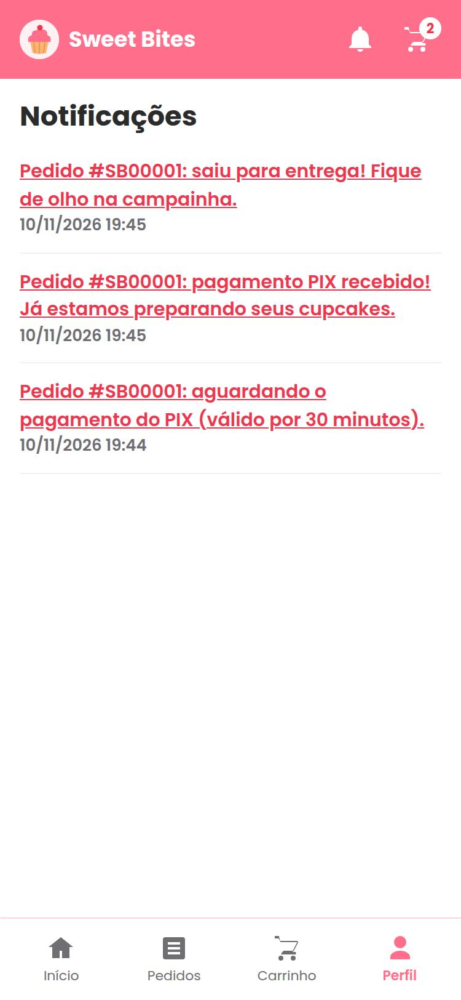 | 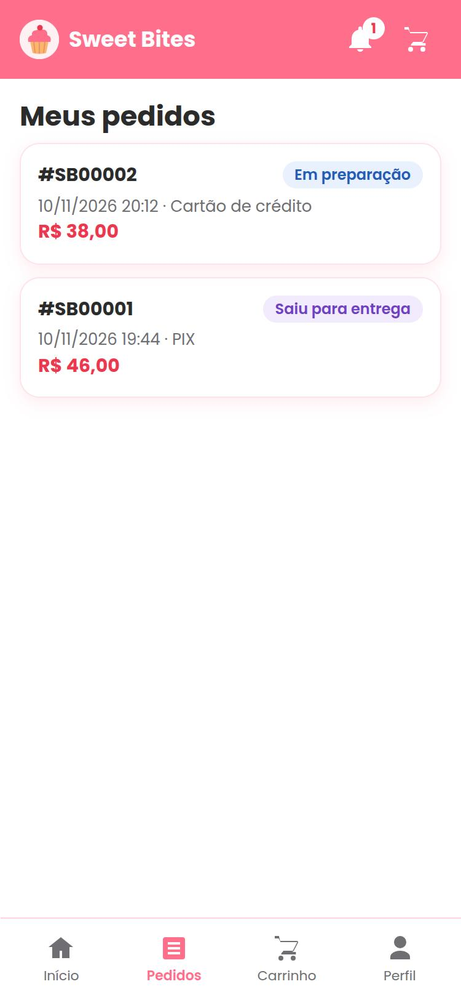 |

## 9.4 Telas do administrador (desktop)

**Painel**: contadores por status e alerta de estoque baixo
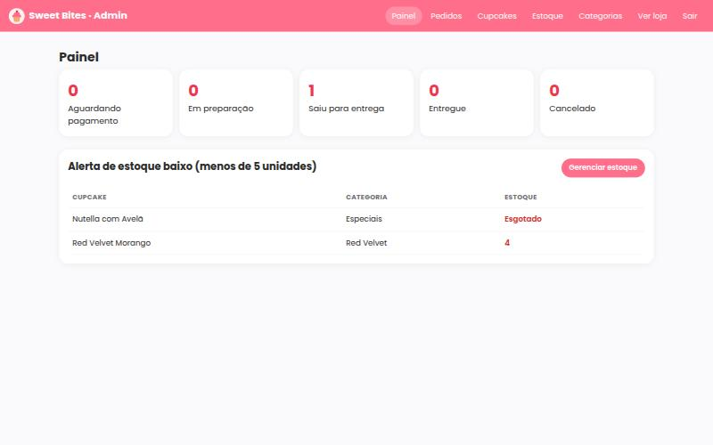

**Pedidos**: filtro por status e período
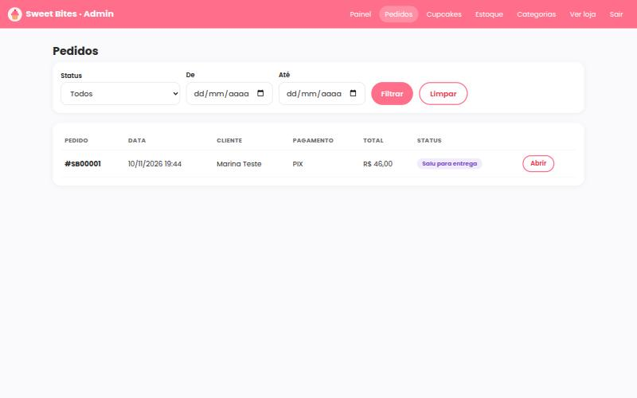

**Detalhe do pedido**: avançar status ou cancelar
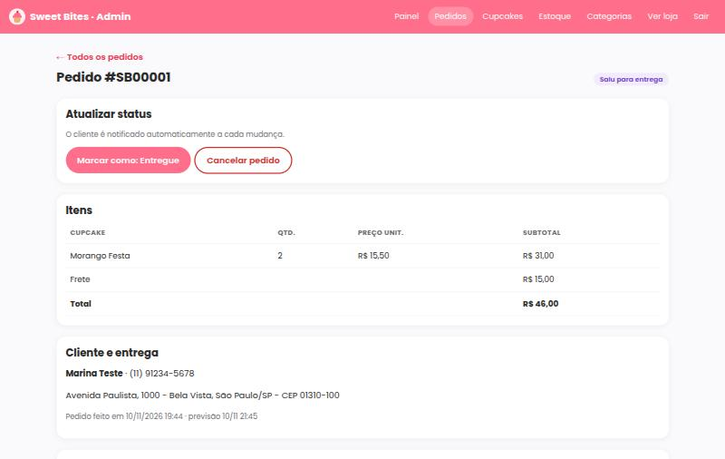

**Cupcakes**
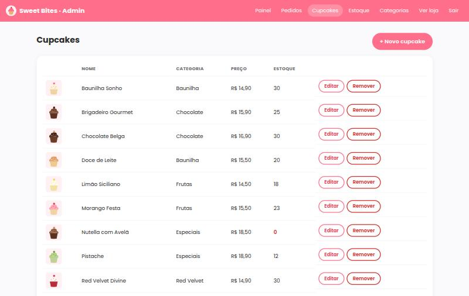

**Editar cupcake**: com upload de foto
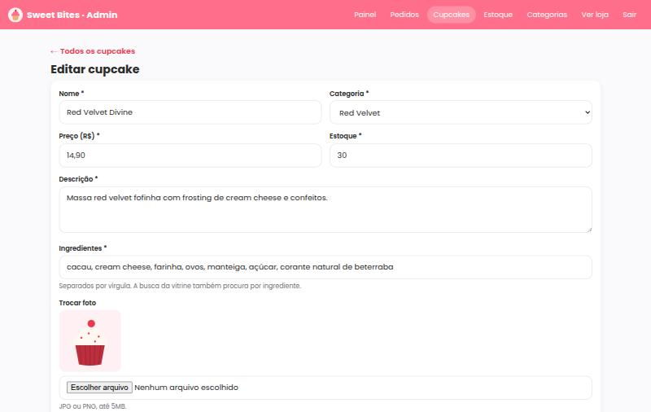

**Estoque**
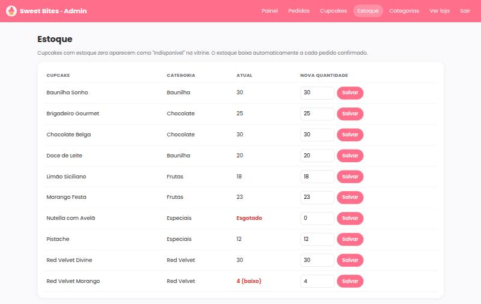

## 9.5 Artefatos originais do PIT I

Mantidos para comparação em [`imagens/pit1-original/`](imagens/pit1-original/): [wireframes](imagens/pit1-original/wireframes.jpg), [mapa navegacional](imagens/pit1-original/mapa-navegacional.jpg) e [mockups](imagens/pit1-original/mockups.jpg).
